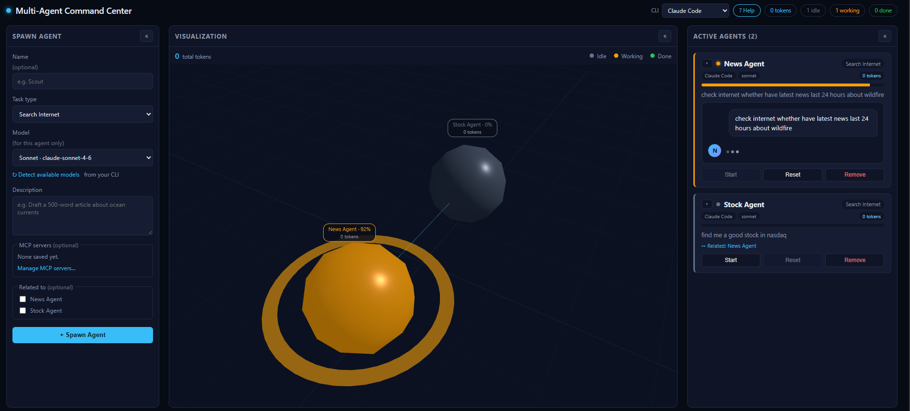
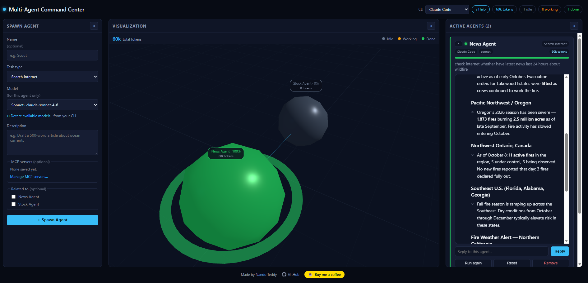
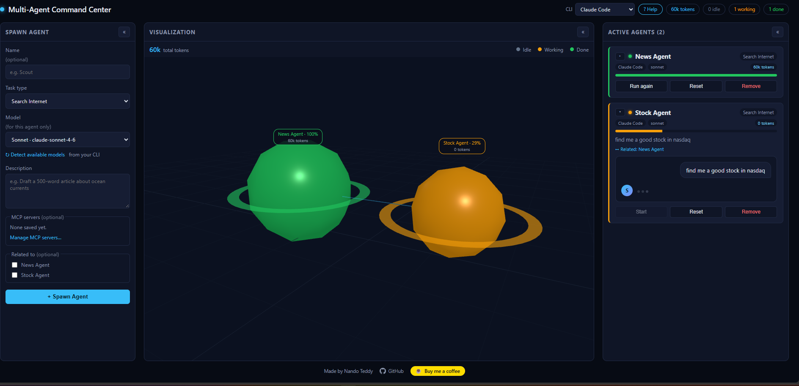
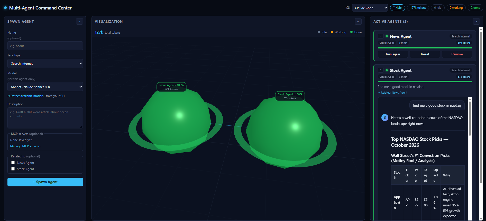
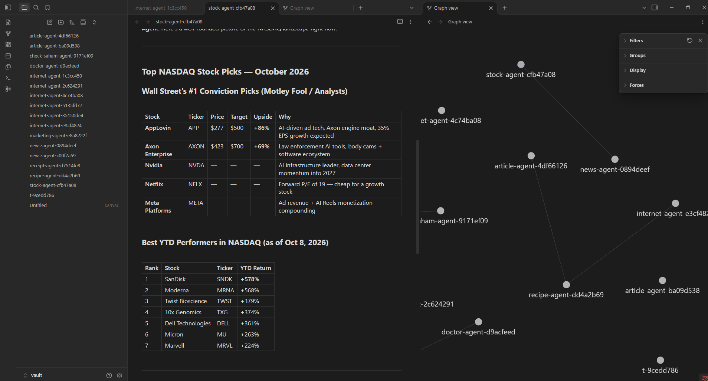
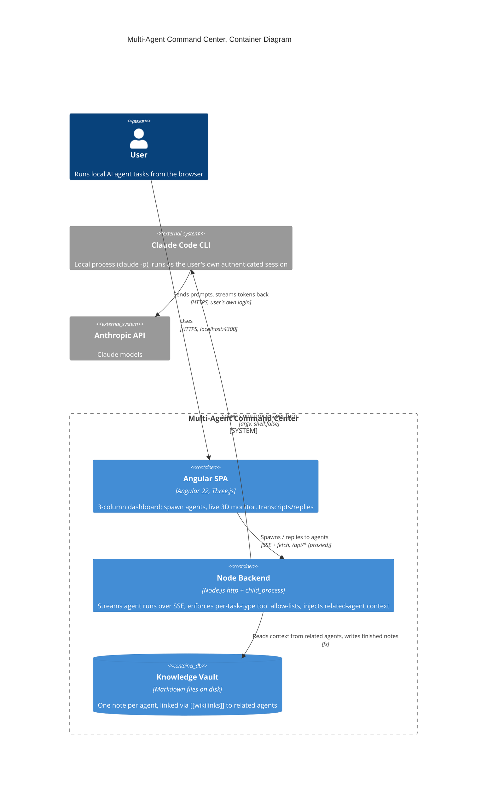

# Multi-Agent Command Center

[](LICENSE) [](https://github.com/ndoteddy/ndo-multi-agent-command-center/stargazers) [](https://buymeacoffee.com/nandoteddy)

[](https://github.com/ndoteddy/ndo-multi-agent-command-center/actions/workflows/ci.yml) [&logo=github)](https://github.com/ndoteddy/ndo-multi-agent-command-center/actions/workflows/codeql.yml) [](https://github.com/ndoteddy/ndo-multi-agent-command-center/blob/main/package.json) [](https://github.com/ndoteddy/ndo-multi-agent-command-center/commits/main) [](https://nodejs.org) [](https://angular.dev) [](https://threejs.org) [](https://github.com/ndoteddy/ndo-multi-agent-command-center/pulls)

A command center for spawning and watching AI agents work, built **on top of
the AI command-line tools you already have**. It isn't tied to one vendor:
today it supports [Claude Code](https://claude.com/claude-code),
[Gemini CLI](https://github.com/google-gemini/gemini-cli) and
[GitHub Copilot CLI](https://docs.github.com/en/copilot/concepts/agents/about-copilot-cli),
with more CLIs planned. Because those tools can serve many models between
them (Claude, Gemini, GPT and more through Copilot), you can mix CLIs and
models in the same session: one agent drafting on Claude Opus, another
searching on Gemini Flash, a third on GPT, each with its own model and MCP
servers.

Describe a task, pick a task type, and watch it run live in a 3D monitor and
a formatted transcript. Agents can be linked together so one agent's answer
becomes context for another, token usage is tracked per agent and in total,
and every finished conversation is saved as a note in an Obsidian-ready
knowledge vault.

Built with Angular 22 (standalone components + signals) and Three.js, with a
small Node backend that shells out to whichever CLI an agent is set to use.
Adding a new CLI means writing one small adapter in `server/providers.js`.

## Quick Start

**Before anything else:** this app does not handle its own login or billing.
It drives the AI CLIs installed on your machine, so at least one of them
(Claude Code, Gemini CLI or GitHub Copilot CLI) has to already work on its
own. The steps below use Claude Code; the **? Help** button in the app shows
the same steps for Gemini and Copilot.

1. Install the [Claude Code CLI](https://claude.com/claude-code) and sign in.
   Confirm it actually works first: open a terminal, run `claude`, and send
   it one message. You need an active Claude subscription (or API billing)
   at this step, not later, since if a plain `claude` session can't chat,
   this app can't either.
2. Install [Node.js](https://nodejs.org/) 20+ and npm.
3. Clone this repo and install its dependencies:
   ```bash
   npm install
   ```
4. Run it. You need **two terminals**, both left open:
   ```bash
   # Terminal 1: the backend that talks to the claude CLI
   npm run server

   # Terminal 2: the Angular dev server
   npm start
   ```
5. Open **http://localhost:4300**. The dev server proxies `/api/*` to the
   backend on port 4000 (see `proxy.conf.json`), so that's the only URL you
   need.

See [Using it](#using-it) below for a walkthrough of the UI, and
[Troubleshooting](#troubleshooting) if `npm run server` can't find `claude`.

## Why this exists

Running a few Claude Code sessions at once for different jobs (draft this,
research that, summarize the other thing) normally means juggling separate
terminal windows by hand. That has three concrete problems this project
fixes:

- **No overview.** With agents running in separate terminals, there's no
  single place to see at a glance who's idle, who's working, and who's
  finished. The 3D monitor gives you that at a glance, for one agent or ten.
- **No composability.** Each terminal session is its own silo: if one agent's
  research should feed into another agent's writing task, you'd normally have
  to copy-paste between terminals yourself. Marking an agent "related to"
  another automatically injects the first agent's finished answer as context
  for the second, so small agent pipelines are one checkbox away instead of
  manual copy-paste.
- **No memory after the terminal closes.** A CLI session's output is gone the
  moment you close the window. Every agent conversation here is written to a
  Markdown note in `vault/`, which doubles as an Obsidian vault, so the work
  accumulates into a browsable, linked knowledge base instead of evaporating.

In short: the `claude` CLI already does the hard part (actually doing the
task, safely, with real tool access). This app adds a control-room layer on
top of it: visibility, linking agents together, and persistence.

## Screenshots

An agent working: its sphere pulses amber in the 3D monitor, the card shows
which CLI and model it runs on, and the spawn form detects the models your
CLI offers:



A finished agent. The answer renders as formatted text, the sphere turns
green, and the header and monitor show the running token total:



Two related agents, one done and one still working, linked by a live line in
the 3D monitor:



Both agents done, each sphere labelled with its own token usage and the
total across all agents in the corner:



The generated knowledge vault opened in Obsidian. The graph view shows how
agents connect, and each note holds the full conversation:



## Features

- **Spawn agents** with a name, a task type, and a plain-English brief.
- **Three task types**, each with a different tool allow-list:
  - **Draft Article**: pure text generation, no tools.
  - **Search Internet**: can use `WebSearch` / `WebFetch` to look things up
    and answer with real, current information (prices, news, facts, sources).
  - **Generic Task**: pure text generation, no tools.
- **Live 3D monitor** (Three.js): each agent is a sphere that's gray/idle,
  pulsing amber/working, or glowing green/done. Related agents are connected
  by a live line.
- **Reply to an agent**: conversations are multi-turn. If an agent asks a
  clarifying question, you can answer it in the same thread instead of
  starting over.
- **Related agents & knowledge vault**: mark a new agent as "related to" an
  existing one, and its finished answer is automatically fed to the new agent
  as context. Every agent's full conversation is also written to
  `vault/<name>.md`, with a "Related Agents" section linking to the agents
  it's connected to. Open the `vault/` folder directly in
  [Obsidian](https://obsidian.md) and its graph view will show those
  connections automatically.
- **Choose your CLI**: the header dropdown picks which command-line tool new
  agents run on: Claude Code, Gemini CLI, or GitHub Copilot CLI. The **? Help**
  button shows install, sign-in and verify steps for each and detects whether
  it's installed. Each agent keeps the CLI it was spawned with.
- **Per-agent model**: pick a model preset (or type any model name) when
  spawning, independently for every agent.
- **Token tracking**: input/output tokens per reply, per agent (on each card
  and under each sphere in the 3D monitor), and a running total in the header.
  Claude and Gemini report exact counts; Copilot doesn't, so its numbers are
  estimated (~4 characters per token) and shown with a `~`.
- **MCP servers per agent**: save MCP servers once (stdio command or HTTP
  URL) via **Manage MCP servers** in the spawn form, then tick the ones each
  agent should get. The library is stored in `config/mcp-servers.json`
  (gitignored, since it can hold API keys) and translated into each CLI's own
  config format at run time.
- **Readable answers**: replies render as formatted text (headings, lists,
  tables, syntax-highlighted code with a copy button) and are sanitized
  before display.
- **Three collapsible columns** (Spawn Agent, Visualization, Active Agents),
  plus each individual agent card in the roster can be collapsed on its own
  once you have a few running.

## How it works

A C4 container diagram of the whole system: a user drives the Angular SPA,
which talks to a small Node backend over SSE, which in turn spawns the
`claude` CLI as a child process and reads/writes the knowledge vault on disk.
The CLI itself (not this app) talks to the Anthropic API using the user's own
authenticated login.



Each agent gets its own sandboxed temp directory and its own Claude session
(`--session-id` on the first turn, `--resume` on every reply after that), so
conversations stay isolated from your real project and from each other.

## Using it

1. **Spawn an agent** (left column): give it a name (optional), pick a task
   type, and write a brief. If you already have other agents running, you can
   check off which ones this new agent is "related to."
2. Click **Start**. Watch it in the **Visualization** column (middle): the
   sphere pulses amber while it's working, and read the streamed response as
   it arrives in the **Active Agents** column (right).
3. If the agent asks a question or you just want to follow up, type into the
   **Reply** box under its transcript and hit Enter. It remembers the whole
   conversation.
4. **Run again** re-sends the original brief as a new turn in the same
   conversation. **Reset** clears the conversation and starts fresh next time.
   **Remove** takes it off the board (its vault note is kept).
5. Click **«** / **»** on any column header to collapse or expand it, or the
   small triangle on an individual agent card to collapse just that card.
6. Open the `vault/` folder in Obsidian any time to browse past
   conversations and see how agents connect to each other in the graph view.

## Safety notes

This runs a real agent with real tool access from a web form, so a few
guardrails are built in (see `server/index.js`):

- Every run executes in a freshly created OS temp directory, never your
  project folder.
- Tool access is an explicit allow-list per task type. Draft Article/Generic
  get **no tools at all**. Search Internet gets only `WebSearch`/`WebFetch`.
  `Bash`, `Edit`, `Write`, `Read`, `Glob`, `Grep`, and `NotebookEdit` are
  always blocked, enforced twice (`--allowedTools` and `--disallowedTools`).
- The agent's brief is always passed as a single argv argument with
  `shell: false`. It is never interpolated into a shell command string, so it
  can't break out into arbitrary commands no matter what you type.
- Each run is capped at **$0.50** (`--max-budget-usd`) and **90 seconds**.
- Using this spends real usage on your Claude account on every "Start" /
  "Reply" click. There's no separate billing; it's your own CLI login.

## Customizing agent personas

Claude Code's default system prompt frames it as a software-engineering
assistant, which makes it reflexively refuse unrelated requests (for example,
"I'm a software engineering assistant and can't search for flight tickets")
even when a tool like `WebSearch` is explicitly enabled. To fix that, each
task type gets a persona appended on top of (not replacing) the default
system prompt via `--append-system-prompt`.

To change an existing persona, edit `SYSTEM_PROMPT_ADDITIONS` in
`server/index.js`:

```js
const SYSTEM_PROMPT_ADDITIONS = {
  'draft-article': 'For this session, act as a general-purpose writing assistant...',
  'web-search': 'For this session, act as a general-purpose web research assistant...',
  generic: 'For this session, act as a general-purpose assistant...',
};
```

To add a brand-new task type (persona + its own tool access), you need to
touch four places so the frontend and backend agree on the type's name:

1. `server/index.js`: add the new key to `ALLOWED_TOOLS`, `DISALLOWED_TOOLS`,
   and `SYSTEM_PROMPT_ADDITIONS`.
2. `src/app/models/agent.model.ts`: add the new value to the `AgentTaskType`
   union and a label to `TASK_TYPE_LABELS`.
3. `src/app/spawn-agent/spawn-agent.ts`: add it to the `taskTypes` array so
   it shows up in the spawn form's dropdown.

Restart `npm run server` after editing `server/index.js`; the frontend picks
up its changes automatically since `ng serve` hot-reloads.

## Project structure

```
src/app/
  spawn-agent/        Spawn form (left column)
  monitor/             Three.js live visualization (middle column)
  agent-roster/        Agent list, transcripts, replies (right column)
  shared/
    collapsible-panel/ Reusable collapsible column wrapper
  services/agent.ts     Single source of truth (signals) + SSE client
  models/agent.model.ts Agent/Turn types

server/index.js         Node backend: spawns the chosen CLI, streams SSE, writes
                         vault notes, injects related-agent context
server/providers.js     Per-CLI adapters (claude, gemini, copilot): argv, MCP
                         config, output + token parsing
server/mcp-store.js     Saved MCP server library (config/mcp-servers.json)

config/                 Saved MCP servers (gitignored)

vault/                  Generated Markdown notes (open as an Obsidian vault)
```

## Support my experiments

I enjoy exploring AI agents, cloud engineering, and building things just to
see what's possible.

If something I've shared helps you or inspires your next project, consider
[buying me a coffee](https://buymeacoffee.com/nandoteddy). Your support helps
me spend more time experimenting, learning, and sharing with the community.
No pressure: a star, a share, or a conversation is always appreciated!

[](https://buymeacoffee.com/nandoteddy)

## Troubleshooting

- **"Could not start claude CLI: spawn claude ENOENT"**: the backend
  couldn't find the `claude` executable. Make sure `claude --version` works
  in your terminal. On Windows, the backend resolves the real `claude.exe`
  under npm's global install directory automatically; if you installed it a
  different way, you may need to adjust `resolveClaudeBinary()` in
  `server/index.js`.
- **No output when clicking Start**: check that `npm run server` is still
  running in its own terminal. The Angular dev server alone can't talk to
  Claude.
- **Port already in use**: the backend listens on `4000`
  (`PORT=4001 npm run server` to change it) and the frontend on `4300`
  (`ng serve --port 4301`). Update `proxy.conf.json` if you change the
  backend's port.

## License

MIT. See [LICENSE](LICENSE).
